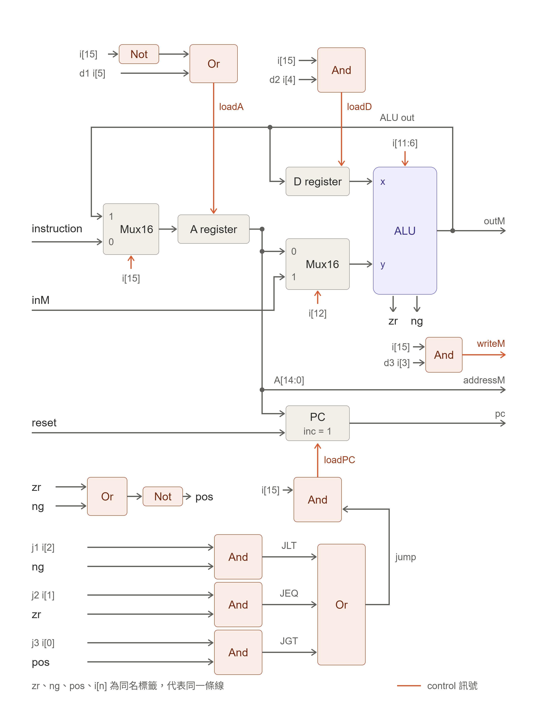

每週檢驗表格

第幾週 |  習題內容 | 有上課且準時繳交 |  補交且附上請假證明 | 作業連結
-------|----------|--------------------|---------------------|-------------
3          | 第 1, 2 章   |   是 |   | [01](https://github.com/s111410540-hub/_co_hw/tree/main/01), [02](https://github.com/s111410540-hub/_co_hw/tree/main/02)
4          | 第3 章除 PC | 是 |     |  [03](https://github.com/s111410540-hub/_co_hw/tree/main/03) | 
5          | 第 4 章 | 是 |  |  [04](https://github.com/s111410540-hub/_co_hw/tree/main/04) | 
6          | HackCPU 電路圖 | 是 |  |[06](https://github.com/s111410540-hub/_co_hw/blob/main/05/20261015_113406.jpg) | 
7          | 第 5 章 | 是 |  |  [05](https://github.com/s111410540-hub/_co_hw/tree/main/05) | 
8          | EDA 軟體報告 | 是 |   | [EDA](https://github.com/s111410540-hub/_co_hw/blob/main/EDA/eda.md)| 

## 課堂筆記 
by HackMD
### [HW1 Boolean Logic](https://hackmd.io/oiaScvCAQOKm7dh6QkhzHQ)
### [HW2 Boolean Arithmetic](https://hackmd.io/LP_7mPtlTNOjB6n-Q9KqYQ)
### [HW3 Sequential Logic](https://hackmd.io/rmEuHgKATxaiN_QGHCXLiw)
### [HW4 Machine Language](https://hackmd.io/0LXfDXZlSpS3lERF256qJA)
### [HW5 Computer Architecture](https://hackmd.io/rUXDR8CKQTClXdExS_ll-w)

## 每章檢驗

### 第一章
- 所有程式碼皆手寫
- 每一個 CHIP 皆測試過

數位邏輯的複習課程，這禮拜去重新翻了數位邏輯的 布林代數 跟 基本元件 ，然後去重新去用K-MAP 去複習布林代數的化簡

此外也去學了Hack HDL 的內容

[第一章 - 手寫筆記]()

## 第二章
- 所有程式碼皆手寫
- 每一個 CHIP 皆測試過

這裡開始難度變很大，前面的half adder 、full adder 都還行
主要是難在ALU，要先有以下的架構，然後再去慢慢拆解

> 前處理（調變 $x, y$） $\to$ 核心運算（$f$） $\to$ 後處理（$no$）

[第二章 - 手寫筆記]()

## 第三章
- 所有程式碼皆手寫
- 每一個 CHIP 皆測試過

第三章應該是我最痛苦的一章了，吃了前面數位邏輯沒學好FF的虧
這次一樣重新學了從SR-latch 到DFF 的過程

然後這裡最難應該是RAM8 ，要先去理解寫入端&讀取端的差異
然後還要先使用組合電路再去接Register
後面就只是不斷地疊加記憶體上去
原則是離不開`DMux8Way`跟`Mux8Way16`這兩個組合電路

[第三章 - 手寫筆記]()

## 第四章
- 有使用claude輔助
- 每一個 CHIP 皆測試過

這章就是新東西了，這是我第一次寫組合語言，以前只有在解析exe的時候反組譯看到，而且還要轉成C，否則根本看不懂

這裡一樣要先知道規則
如分清楚 A、D、M的定義，然後再去學兩種基本指令

## 第五章
- 有使用claude輔助
- 每一個 CHIP 皆測試過 

這張就是總和前面的ALU、跟RAM
專案最終要求的Computer反而還好，有圖片可以直接看著接
Memory則是要注意adreess的範圍，不要接錯了

最難的還是CPU

光是畫圖就花不少時間了
主要先注意`instruction`每一個的定義，才不會亂接線

